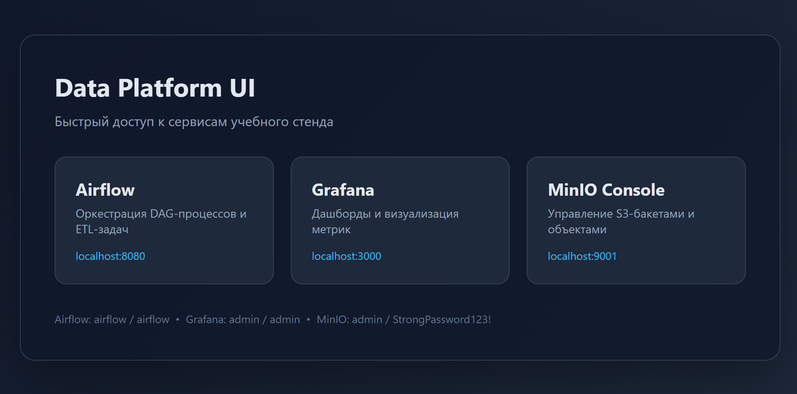
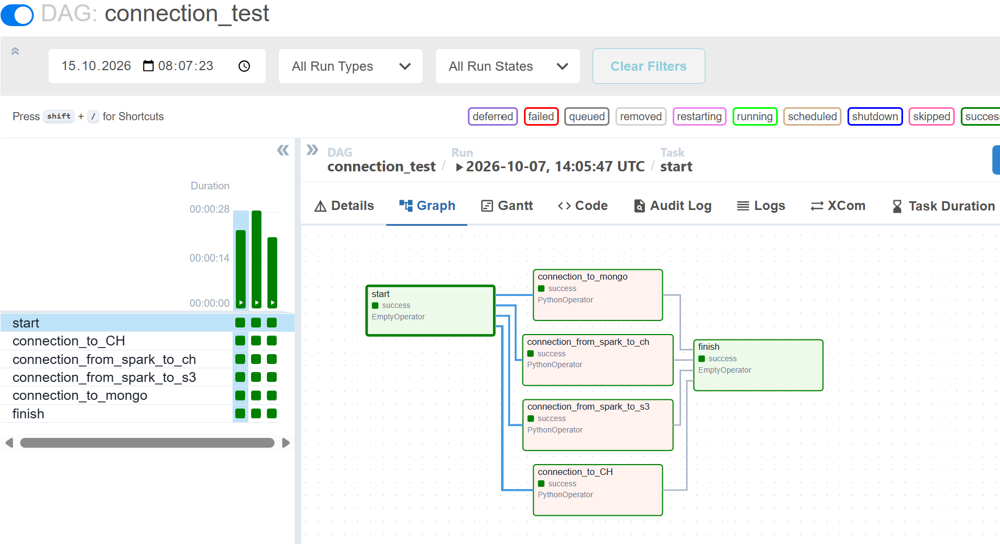
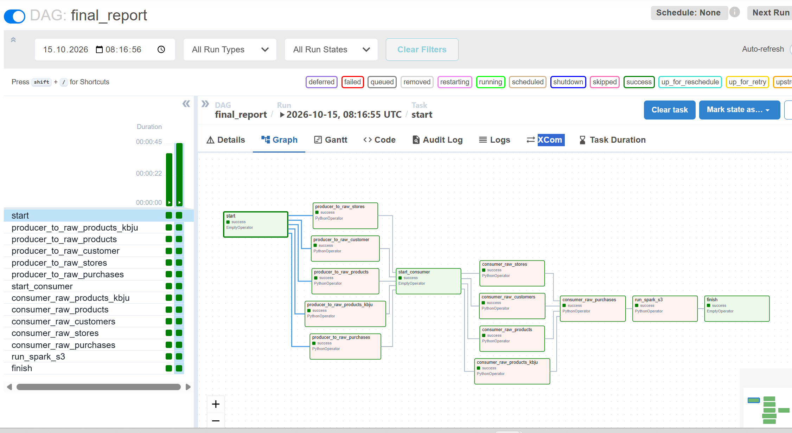
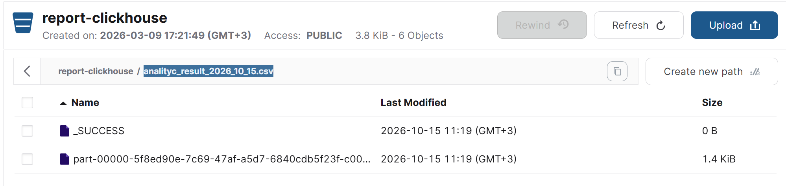
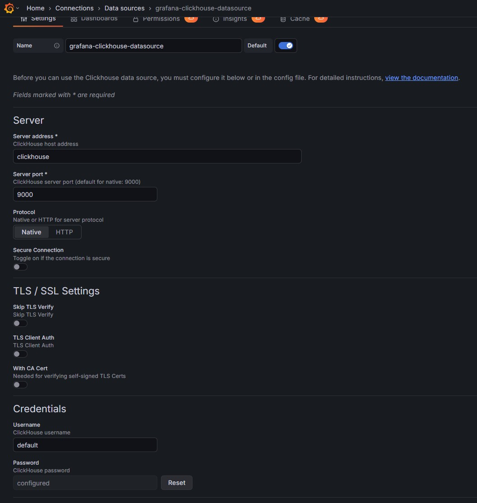
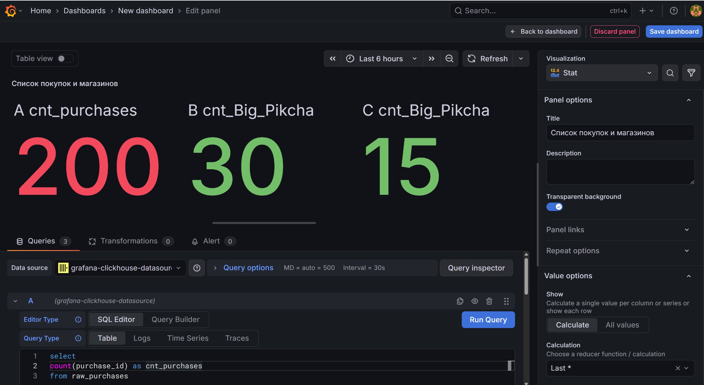
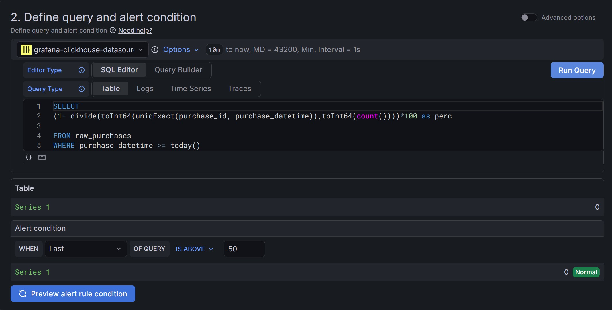
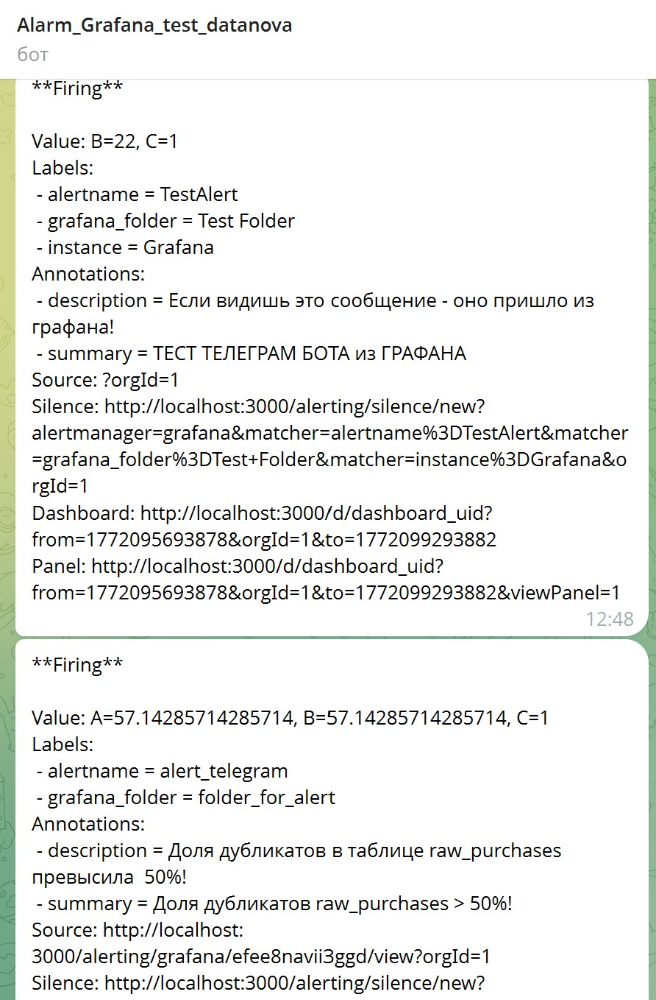

# 🚀 Формирование DWH для аналитики сетевого магазина

Учебный data-engineering проект: реализует ETL-pipeline для формирования аналитического DWH сетевого магазина «Пикча».

Данные из **MongoDB** поступают через **Kafka** в **ClickHouse** (слои `RAW` и `MART`), после чего формируется готовый CSV-отчет и выгружается в **MinIO** — S3-совместимое объектное хранилище.


## 🧭 Содержание

- [Архитектура](#-архитектура)
- [Технологии](#%EF%B8%8F-используемые-технологии)
- [Быстрый старт](#-быстрый-старт)
- [Настройка Airflow](#%EF%B8%8F-настройка-connections-в-airflow)
- [Генерация данных и запуск ETL](#-генерация-данных-и-запуск-etl)
- [Логика ETL](#-логика-etl)
- [Аналитический отчет](#-аналитический-отчет)
- [Проверка результата в MinIO](#-проверка-результата-в-minio)
- [Grafana и алертинг](#-grafana-и-алертинг)
- [Критерии выполнения](#-критерии-выполнения)
- [Структура проекта](#-структура-проекта)

## 🏗️ Архитектура


Основные компоненты:

- **MongoDB** — источник исходных данных.
- **Kafka** — транспортный слой между источником и DWH.
- **ClickHouse RAW** — прием «сырых» данных из Kafka.
- **ClickHouse MART** — очищенные и обогащенные аналитические витрины.
- **MinIO** — хранение итогового CSV-отчета.
- **Airflow** — оркестрация ETL-процесса.
- **Grafana** — мониторинг данных и алертинг в Telegram.

## 🛠️ Используемые технологии

| Компонент | Назначение |
|---|---|
| 🐳 Docker Compose | Локальная инфраструктура проекта |
| 📊 ClickHouse | Хранилище слоев `RAW` и `MART` |
| 🗄️ MongoDB | Источник данных |
| 📡 Kafka | Producer/Consumer, потоковая передача данных |
| 🌬️ Apache Airflow | Оркестрация ETL |
| ⚡ PySpark / Jupyter | Обработка и подготовка данных |
| ☁️ MinIO | S3-совместимое хранилище отчетов |
| 📈 Grafana + ClickHouse plugin | Дашборды и мониторинг |
| 🤖 Telegram Bot | Уведомления об алертах |

## ⚙️ Требования

Перед запуском убедитесь, что установлены:

- Docker
- Docker Compose
- Python 3.x
- Git

## 🚀 Быстрый старт

### 1. Клонируйте репозиторий

```bash
git clone <URL_ВАШЕГО_РЕПОЗИТОРИЯ>
cd <название_проекта>
```

### 2. Создайте виртуальное окружение

```bash
python -m venv .venv
source .venv/bin/activate      # macOS / Linux
# .venv\Scripts\activate       # Windows PowerShell
```

### 3. Установите Python-зависимости

```bash
pip install -r requirements.txt
```

Зависимости нужны для локального запуска скриптов вне Airflow.

### 4. Подготовьте JAR-библиотеки

Создайте папку `jar` и добавьте туда библиотеки, указанные в `requirements_jars.txt`:

```bash
mkdir -p ./jar
```

### 5. Создайте файл `.env`

Создайте `.env` в корне проекта и добавьте необходимые переменные окружения: ключи, пароли и настройки сервисов.

> ⚠️ Не коммитьте `.env` в Git. Добавьте его в `.gitignore`.

### 6. Создайте служебные директории

```bash
mkdir -p ./dags ./logs ./plugins ./data ./scripts
```

### 7. Соберите кастомный образ Airflow

```bash
docker build -t airflow-with-java .
```

### 8. Инициализируйте Airflow

Выполняется только при первом запуске:

```bash
docker compose up airflow-init
```

Команда выполняет миграцию БД Airflow и создает первого пользователя.

### 9. Запустите инфраструктуру

```bash
docker compose up -d
```

После запуска откройте веб-интерфейс: http://localhost/

| Сервис | URL |
|---|---|
| Airflow | http://localhost:8080 |
| MinIO Console | http://localhost:9001 |
| Grafana | http://localhost:3000 |



## 🔐 Настройка Connections в Airflow

### `clickhouse_default`

Подключение через нативный порт ClickHouse.

| Параметр | Значение |
|---|---|
| Connection Id | `clickhouse_default` |
| Host | `clickhouse` |
| Port | `9000` |
| Login | `default` |
| Password | `password` |

### `clickhouse_http`

Подключение через HTTP-интерфейс ClickHouse, используется JDBC-драйвером Spark.

| Параметр | Значение |
|---|---|
| Connection Id | `clickhouse_http` |
| Connection Type | `Generic` |
| Host | `clickhouse` |
| Port | `8123` |
| Login | `default` |
| Password | `password` |

> Имя хоста `clickhouse` должно совпадать с `container_name` в `docker-compose.yaml`.

### Проверка подключений

В Airflow запустите DAG `connection_test` — он выполняет smoke-тест подключений.



## 📦 Генерация данных и запуск ETL

Выполняйте шаги по порядку.

### 1. Сгенерируйте JSON-данные

```bash
python scripts/001_data_generator.py
```

В папке `data/json` будут созданы:

| Каталог | Объем |
|---|---|
| `stores` | 45 магазинов |
| `products` | 50 товаров |
| `customers` | 45 покупателей |
| `purchases` | 200 покупок |

### 2. Загрузите данные в MongoDB

```bash
python scripts/002_json_to_Mongo.py
```

### 3. Создайте БД и таблицы в ClickHouse

```bash
python scripts/003_generator_bd_clickhouse.py
```

Скрипт создает:

- базу данных `RAW`;
- таблицы `RAW` для магазинов, товаров, КБЖУ, покупателей и покупок;
- базу данных `MART`;
- materialized view для очистки и трансформации данных;
- витрину `mart.clean_purchases`.

Отдельно DDL-скрипты запускать не нужно — они приведены как пример:

- `ddl/002_raw_stores.sql`
- `ddl/003_raw_products.sql`
- `ddl/004_raw_products_kbju.sql`
- `ddl/005_raw_customers.sql`
- `ddl/006_raw_purchases.sql`
- `ddl/001_db_mart.sql`
- `ddl/008_mv_mart_clean_purchases.sql`

### 4. Запустите ETL в Airflow

1. Откройте Airflow: http://localhost:8080.
2. Найдите DAG `final_report`.
3. Запустите DAG вручную.




## 🔄 Логика ETL

### Producer

Файл: `plugins/producers.py`

- Читает данные из MongoDB.
- Шифрует персональные данные: `email` и `phone`.
- Приводит данные к формату для ClickHouse.
- Отправляет сообщения в Kafka-топики:

```text
raw-products-kbju
raw-products
raw-customers
raw-stores
raw-purchases
```

### Consumer

Файл: `plugins/consumers.py`

- Читает сообщения из Kafka-топиков.
- Записывает данные в таблицы слоя `RAW` в ClickHouse.

### Трансформация в MART

- **Materialized View** следит за таблицей `raw_purchases`.
- При появлении новых данных выполняет валидацию `NULL`-значений и дат.
- Обогащает данные через `LEFT JOIN` со справочниками.
- Записывает результат в витрину `mart.clean_purchases`.
- Движок `ReplacingMergeTree` дедуплицирует записи по ключу:

```sql
(purchase_id, purchase_datetime)
```

## 📈 Аналитический отчет

После выполнения DAG формируется файл:

```text
analityc_result_{current_date}.csv
```

Отчет выгружается в MinIO.

### Рассчитываемые признаки

| № | Признак | Описание | Бизнес-смысл |
|---:|---|---|---|
| 1 | `bought_milk_last_30d` | Покупал молочные продукты за последние 30 дней | Признак интереса к молочной категории |
| 2 | `bought_fruits_last_14d` | Покупал фрукты за последние 14 дней | Активность в категории «фрукты» |
| 3 | `not_bought_veggies_14d` | Не покупал овощи за последние 14 дней | Потенциальная точка для стимулирования покупок |
| 4 | `recurrent_buyer` | Более 2 покупок за последние 30 дней | Повторный покупатель |
| 5 | `inactive_14_30` | Не покупал 14–30 дней | Возможный «уходящий» клиент |
| 6 | `new_customer` | Регистрация менее 30 дней назад | Новый клиент |
| 7 | `delivery_user` | Использовал доставку хотя бы один раз | Пользователь доставки |
| 8 | `organic_preference` | Купил хотя бы один органический продукт | Предпочтение органических товаров |
| 9 | `bulk_buyer` | Средняя корзина более 1000 ₽ | Крупный покупатель |
| 10 | `low_cost_buyer` | Средняя корзина менее 200 ₽ | Покупатель с низкой средней корзиной |
| 11 | `buys_bakery` | Покупал хлеб или выпечку хотя бы один раз | Интерес к категории «хлеб/выпечка» |

## ☁️ Проверка результата в MinIO

1. Откройте MinIO Console: http://localhost:9001.
2. Перейдите в бакет с отчетами.
3. Найдите файл `analityc_result_{current_date}.csv`.



## 📊 Grafana и алертинг

1. Откройте Grafana: http://localhost:3000.
2. Установите или проверьте плагин `grafana-clickhouse-datasource`.
3. Настройте Telegram-алертинг по инструкции `telegram_bot_instruction.md`.
4. Для генерации тестовых событий используйте скрипт:

```bash
python scripts/004_generator_ALARM_GRAFANA.py
```

Скрипт добавляет дополнительные события в `raw_purchases`, чтобы проверить срабатывание алертов.









## ✅ Критерии выполнения

| ✓ | Критерий | Статус | Артефакт |
|---|---|:---:|---|
| 1 | Docker Compose с сервисами | ✅ | `docker-compose.yaml` |
| 2 | Генератор данных | ✅ | `001_data_generator.py` |
| 3 | Grafana-дашборд | ✅ | `screenshots/grafana/` |
| 4 | Telegram-алертинг | ✅ | `@alarm_grafana_test_bot` |
| 5 | SQL Materialized View для очистки | ✅ | `ddl/008_mv_mart_clean_purchases.sql` |
| 6 | Grafana Alerting | ✅ | `screenshots/alerts/` |
| 7 | Отчет в MinIO | ✅ | `containers/minio-data/report-clickhouse/` |
| 8 | DAG в Airflow | ✅ | `final_report` |

## 📁 Структура проекта

```text
.
├── dags/                     # DAG-файлы Airflow
├── ddl/                      # SQL DDL для ClickHouse
├── plugins/                  # Producer и Consumer
├── scripts/                  # Скрипты генерации данных и инициализации
├── jar/                      # JAR-библиотеки для Spark
├── data/                     # Сгенерированные JSON-данные
├── logs/                     # Логи Airflow
├── screenshots/              # Скриншоты интерфейсов и результатов
├── docker-compose.yaml
├── requirements.txt
├── requirements_jars.txt
└── README.md
```

## 🧪 Возможные улучшения

- Добавить тесты для Producer, Consumer и SQL-трансформаций.
- Вынести чувствительные значения из дефолтных паролей в `.env`.
- Добавить Makefile с командами `make init`, `make up`, `make down`.
- Добавить версионирование схем Kafka-сообщений.
- Добавить контроль качества данных: количество записей, дубликаты, задержки обработки.